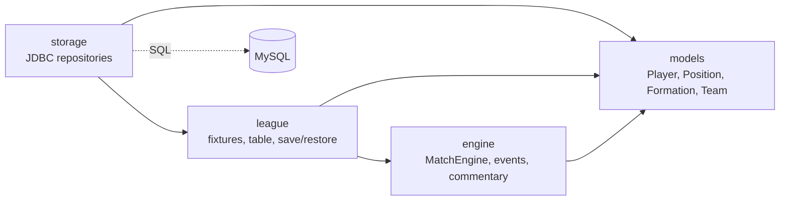
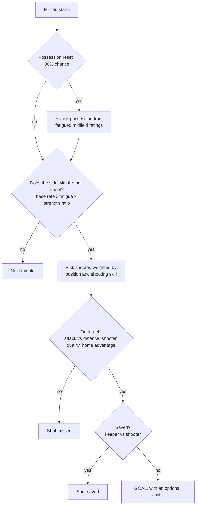
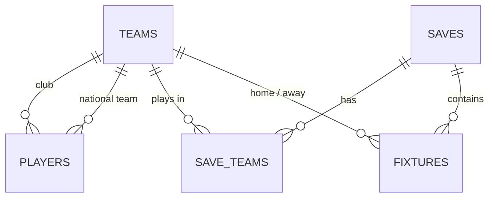

<div align="center">

# ⚽ Football Sim

**A probabilistic football match engine, league simulator and real-ratings database, written in plain Java.**


*Pick any two clubs from 18,000+ real players, play 90 minutes with live commentary, or run a full 20-team league season and save it to MySQL.*

</div>

---

## ✨ Features

| | |
|---|---|
| 🎮 **Match engine** | Minute-by-minute simulation: possession, shots, on-target / saved / goal, assists, fatigue, home advantage, added time, extra time, penalty shootout and sudden death |
| 🗣️ **Live commentary** | Every event is a typed `MatchEvent` rendered into varied commentary lines |
| 📋 **Formation-aware lineups** | Pick any of 9 formations; a greedy algorithm fills the best XI and penalises players who are out of position |
| 🏆 **League simulator** | Round-robin scheduling (home and away), points table with goal-difference tie-breaks, works for any even number of teams (a 20-team season is 380 fixtures) |
| 🗄️ **Real ratings in MySQL** | 18,000+ real players imported from a public EA FC 26 CSV through a staging table and mapped to the game's own attributes and positions |
| 💾 **Save / load** | A league is stored as fixtures and results; the points table is **rebuilt from the results** on load, so it can never drift out of sync |
| 📈 **Calibrated, not guessed** | Engine constants were tuned with Monte Carlo runs (3,000 matches per matchup) until win rates, shots and goals looked realistic |

---

## 🧱 Architecture

The one rule: **dependencies only point one way.** Game logic never knows about the database or any UI, so a console demo, a Swing window or a web frontend can sit on top without changing a line of the engine.



### How one minute of a match is simulated



### Formation-aware lineup selection

`Team.getLineup()` fills the 11 slots of the chosen formation greedily: in each round it looks at every free slot and every unused player and places the pair with the highest score, where

```
score = player overall - positional penalty
```

| Situation | Penalty |
|---|---|
| Exact position | 0 |
| Very close role (e.g. LB at LWB, CM at DMF) | 3 |
| Midfielder on the wing (LMF at LWF) | 7 |
| Same line, different role | 6 |
| Each line away (defence, midfield, attacking midfield, attack) | 8 per line |
| Goalkeeper outfield, or outfielder in goal | 45 |

Team strength (attack, midfield, defence) is the average of the **effective** ratings in those slots, so a badly balanced squad plays worse than its raw ratings suggest.

---

## 📊 Calibration: tuning the engine with Monte Carlo

My first version let the best team beat the worst one **96% of the time**. Instead of guessing, `MonteCarloTest` simulates the same fixture thousands of times and I changed one constant at a time. Mirror matches (the same team on both sides) isolate pure home advantage.

| Fixture (home vs away) | Home win | Draw | Away win | Avg goals | Avg shots |
|---|---|---|---|---|---|
| Liverpool vs Brentford | 75.9% | 15.7% | 8.4% | 2.34 - 0.56 | 17.7 - 8.4 |
| Brentford vs Liverpool | 11.5% | 19.3% | 69.2% | 0.66 - 2.02 | 8.4 - 17.6 |
| Liverpool vs Chelsea | 63.4% | 20.7% | 15.9% | 1.90 - 0.79 | 15.0 - 10.5 |
| Chelsea vs Liverpool | 24.8% | 25.1% | 50.2% | 0.99 - 1.60 | 10.5 - 15.0 |
| Chelsea vs Brentford | 60.1% | 22.8% | 17.1% | 1.73 - 0.76 | 14.7 - 9.7 |
| Chelsea vs Chelsea (mirror) | 41.6% | 24.6% | 33.8% | 1.36 - 1.16 | 12.2 - 12.5 |

*3,000 simulated matches per row, fixed seed. Total goals per match land between roughly 2.5 and 2.9.*


---

## 🖥️ Sample output


---

## 🗄️ Database




Two kinds of data are kept apart on purpose:

- **Master data** (`teams`, `players`): the real-world ratings. The game only reads it.
- **Save-game data** (`saves`, `save_teams`, `fixtures`): what the game writes. There is **no stored points table**; it is recomputed from `fixtures`, so there is one source of truth.

### Import pipeline


```
CSV  ->  raw_players (staging, all VARCHAR)  ->  v_players_mapped (VIEW)  ->  players
```

1. `LOAD DATA LOCAL INFILE` loads only the needed columns into a staging table.
2. A SQL view converts types and maps dataset values to the game's model.
3. `INSERT ... SELECT` fills `players`, linking each player to a club and, when called up, a national team.

**Position mapping** (dataset to game):

| Dataset | Game | | Dataset | Game |
|---|---|---|---|---|
| ST | CF | | CDM | DMF |
| CF | SS | | CM | CMF |
| LW / RW | LWF / RWF | | CAM | AMF |
| LM / RM | LMF / RMF | | GK, CB, LB, RB, LWB, RWB | same |

The dataset lists several positions per player; the first one is used.

**Goalkeepers** have empty outfield stats, so their game attributes are derived: `defending` = average of diving, handling, positioning and reflexes; `passing` = kicking; `shooting` is fixed low.

---

## 🚀 Getting started

### Prerequisites

- JDK **21 or newer**
- MySQL 8 (MySQL Workbench is handy)
- MySQL Connector/J (JDBC driver) JAR
- A public EA FC 26 player CSV (e.g. from Kaggle); **not included** in this repository

### Setup

1. **Clone** the repository and open it in IntelliJ IDEA (a plain project, no Maven/Gradle yet).
2. **Add the JDBC driver:** put the Connector/J JAR in `lib/` and add it as a library (Project Structure, Libraries).
3. **Create the database:** run [`database/schema.sql`](database/schema.sql).
4. **Create an app user** (replace the password):
   ```sql
   CREATE USER 'footballsim'@'localhost' IDENTIFIED BY 'your-password';
   GRANT SELECT, INSERT, UPDATE, DELETE ON football_sim.* TO 'footballsim'@'localhost';
   ```
5. **Import the ratings:** edit the file path at the top of [`database/import_players.sql`](database/import_players.sql) and run it. The column list matches the CSV layout used in development; adjust it if your file differs.
6. **Configure the connection:** copy `db.properties.example` to `db.properties` and fill in your credentials (this file is git-ignored).

### Run the demos

| Class | What it does |
|---|---|
| `Main` | Plays a league of random teams, prints the table and sanity checks |
| `DbTest` | Loads two real clubs from MySQL, prints both lineups and plays a match with commentary |
| `LeagueTest` | Loads a full league from MySQL, simulates the season, prints the table and checkpoints |
| `SaveLoadTest` | Saves a half-played season, reloads it, and verifies the table is identical |
| `MonteCarloTest` | Simulates the same fixtures thousands of times and prints win rates, goals and shots |


---

## 🗂️ Project structure

```
football-sim/
├── database/
│   ├── schema.sql              # tables
│   └── import_players.sql      # staging import, mapping view, population
├── src/
│   ├── models/                 # Player, Position, Formation, Team
│   ├── engine/                 # MatchEngine, MatchEvent, EventType, Commentary
│   ├── league/                 # Fixture, TableEntry, League
│   ├── storage/                # Db, TeamRepository, MySqlTeamRepository, LeagueRepository
│   └── *.java                  # runnable demos (Main, DbTest, LeagueTest, ...)
├── db.properties.example
└── README.md
```

---

## 🧠 Design decisions

- **Layered, one-way dependencies.** `models` knows nothing about `engine`, `storage` or any UI.
- **The table is derived, not stored.** Rebuilding it from fixtures on load removes a whole class of consistency bugs.
- **Staging table first.** Dirty CSV data (empty cells, multiple positions, extra columns) is cleaned in SQL, not in Java.
- **`PreparedStatement` everywhere** and **transactions** for saves, so a failed save never leaves half a league behind.
- **Seeded randomness.** The engine takes a `Random`, so any season or match can be replayed exactly.
- **Measure, then tune.** Engine constants live at the top of `MatchEngine`, and every change was checked against simulated win rates.

---

## ⚠️ Known limitations

- Ratings use five attributes (pace, passing, shooting, defending, stamina). The dataset's dribbling and physical stats are not used, so game overalls are a few points below the original ones, though the relative order of players and teams is preserved.
- It is a statistical simulation, not a positional one: there is no pitch geometry, and fouls, cards and injuries are not simulated yet.
- Leagues are identified by name only; a few clubs that share a league name across countries had to be relabelled during import.

---

## 🛣️ Roadmap

- [x] **Part 1: backend.** Models, match engine, events and commentary, league, MySQL storage, save / load, Monte Carlo calibration
- [ ] **Part 2: REST API.** Spring Boot service exposing leagues, seasons, tables, fixtures and match simulation
- [ ] **Part 2: web UI.** React frontend with league table, fixtures and an animated match timeline
- [ ] Cards, injuries and substitutions
- [ ] Unit tests (JUnit) for the league and storage layers

---

## 📝 Data and credits

Player ratings come from a public EA FC 26 dataset. This is an independent educational project and is **not affiliated with or endorsed by EA**. The dataset is not redistributed here.

Built by **Rupayan Dey** (rupayanxi5567 (https://github.com/rupayanxi5567)). I used AI as a pair-programming partner; the design decisions, debugging and tuning were mine.
